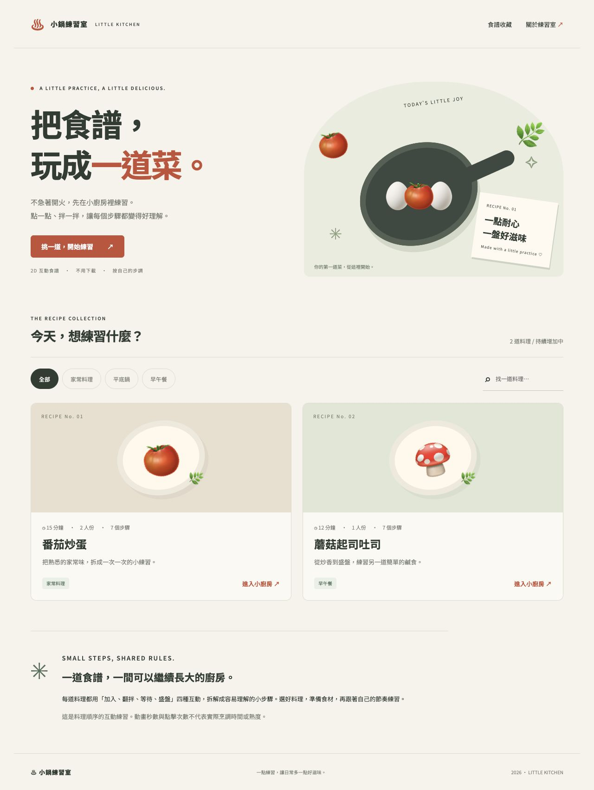

# 小鍋練習室 LITTLE KITCHEN

把食譜轉為 2D 互動練習的靜態網站。本專案的核心是可重複的轉換流程，而非每道菜各寫一個網頁。

## 網頁截圖



## 快速開始

需要 Python 3（預覽）與 Node.js（資料驗證），網站本身不需安裝套件。

```sh
python3 -m http.server 8000 --directory dist
```

開啟 http://localhost:8000 。不要直接雙擊 HTML，瀏覽器可能阻擋 JSON 載入。

```sh
node scripts/validate.mjs
node --check dist/app.js
```

## 如何繼續做

先讓 AI 讀 AGENTS.md，再提供一份食譜，使用 docs/new-recipe-prompt.md 的指令。AI 將素材拆成 `add / mix / wait / serve`，在 dist/data/recipes.json 加入資料；首頁、篩選、搜尋、步驟與網址自動生成。docs/recipe-template.json 可直接當欄位範本。遇到新型態動作先確認是否能用現有動作表達；確實需要新動作時同時更新引擎、驗證器、規則與測試。

現有兩份 AI 自編教學食譜使用同一套引擎，未經實作驗證；模擬時間不代表實際料理時間。

## 已部署網站

https://hitchhikerbwy.github.io/little-kitchen/

## GitHub 與公開網站

GitHub Repository：https://github.com/Hitchhikerbwy/little-kitchen

開發規則：[AGENTS.md](AGENTS.md)。

以下流程供重新建立或設定 GitHub Pages 時使用。

1. 在 GitHub 建立名為 little-kitchen 的 Public Repository，不先新增 README。
2. 上傳本資料夾內容，保留 dist、scripts、docs 與 AGENTS.md 的層級。
3. 在 Repository → Settings → Pages → Build and deployment 選 GitHub Actions。
4. 本專案的 `.github/workflows/pages.yml` 會驗證資料，再將 dist 部署至 Pages。
5. 到 Actions 等待 Deploy to GitHub Pages 成功，在 Pages 頁複製實際網址。不要把本機網址當公開網址。

ZIP 使用命令列解壓可保留隱藏的 .github 資料夾。若網頁上傳未包含該資料夾，可另建 `.github/workflows/pages.yml`，貼入原檔內容。

## 檔案

- AGENTS.md：AI 可持續開發規則。
- dist/：網站與食譜資料。
- scripts/validate.mjs：資料契約檢查。
- docs/：範本、新增指令、擴充紀錄與繳交草稿。
- .github/workflows/pages.yml：自動驗證與 GitHub Pages 部署。
